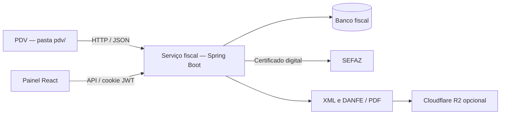

# Microservices — serviço fiscal ISA

Projeto acadêmico para demonstrar a integração entre um PDV (ponto de venda) e um serviço fiscal por API HTTP/JSON. Este repositório contém o **serviço fiscal** e seu painel React na raiz, e o **PDV** na pasta [pdv/](pdv/). Consulte também o [README do PDV](pdv/README.md).

## Arquitetura



O PDV cuida das vendas e envia seus itens ao fiscal. O fiscal concentra os dados do emitente, montagem e assinatura de XML, comunicação com a SEFAZ, histórico e documentos. Os serviços devem rodar em processos próprios, com configuração e persistência próprias, comunicando-se pela API. O PDV não deve acessar diretamente as tabelas fiscais.

O backend atual é um único serviço Spring Boot organizado em camadas. Controllers, services e repositories são componentes internos. O React é um painel empacotado no mesmo JAR. O PDV está disponível em [pdv/](pdv/). Existe uma pendência de autenticação entre as versões publicadas: o fiscal exige cookie JWT além do token, mas o cliente do PDV envia apenas o token. A demonstração integrada exige resolver essa compatibilidade, descrita no [README do PDV](pdv/README.md).

### Fluxo da venda

1. O PDV envia CNPJ da loja, identificador da venda, pagamento e itens.
2. O fiscal localiza a empresa ativa e verifica sua configuração NFC-e.
3. Se já houver nota autorizada ou pendente para empresa, origem ISA e venda, reaproveita o resultado. Isso reduz duplicações sequenciais; não garante processamento exatamente uma vez sob concorrência.
4. O fiscal monta o documento, comunica-se com a SEFAZ e registra o resultado.
5. XML e PDF ficam disponíveis por API. R2 é opcional, com fallback no banco e cache local.

## Funcionalidades e tecnologias

- Emissão, consulta, cancelamento e prévia de XML de NF-e e NFC-e.
- Cadastro multiempresa, produtos, clientes, usuários e histórico fiscal.
- JWT em cookie HttpOnly, senhas de usuários com BCrypt e administração de usuários restrita ao perfil ADMIN.
- Java 21, Spring Boot 4.0.0, Spring Security, JPA, Flyway e Maven Wrapper.
- H2 local e suporte a PostgreSQL.
- React 19, TypeScript e Vite integrados ao build Maven.
- Biblioteca wmixvideo/nfe, PDF local, Meu Danfe e Cloudflare R2 opcionais.

## Estrutura

| Diretório | Responsabilidade |
| --- | --- |
| src/main/java/isakids/nfcelab/controller | APIs HTTP |
| src/main/java/isakids/nfcelab/service | Regras e integração PDV |
| src/main/java/isakids/nfcelab/fiscal | XML, certificado e SEFAZ |
| src/main/java/isakids/nfcelab/document | PDF e armazenamento |
| src/main/java/isakids/nfcelab/security | Autenticação e JWT |
| src/main/java/isakids/nfcelab/entity e repository | Persistência |
| src/main/resources/db/migration | Migrações Flyway |
| src/test | Testes automatizados |
| frontend | Painel React |
| examples e docs | Payloads e documentação complementar |

## Configuração e segredos

Use [.env.example](.env.example) como referência. **Spring Boot não carrega .env automaticamente**: exporte as variáveis no terminal, configure-as na IDE/plataforma ou use Docker com --env-file.

| Variável | Uso |
| --- | --- |
| JWT_SECRET | Obrigatória: chave aleatória Base64 com pelo menos 32 bytes; sem chave padrão |
| APP_SECURITY_BOOTSTRAP_ADMIN_ENABLED | true para criar administrador inicial; padrão false |
| APP_SECURITY_BOOTSTRAP_ADMIN_PASSWORD | Senha própria de bootstrap; sem senha padrão |
| APP_INTEGRACOES_PDV_TOKEN | Segredo enviado no header X-Integration-Token |
| AUTH_COOKIE_SECURE | false no desenvolvimento HTTP; true em HTTPS |
| SPRING_DATASOURCE_URL | URL JDBC externa; sem ela usa H2 em arquivo |
| SPRING_DATASOURCE_USERNAME / SPRING_DATASOURCE_PASSWORD | Credenciais do banco externo |
| APP_NFCE_WS_ENABLED | Acesso à SEFAZ; o exemplo usa false |
| NFE_CERTIFICADO_PFX_BASE64 / NFE_CERTIFICADO_SENHA | Certificado digital e senha |
| NFE_CADEIA_JKS_BASE64 / NFE_CADEIA_SENHA | Cadeia de certificados e senha |
| NFE_CSC / NFE_CSC_ID | CSC para NFC-e |
| APP_NFCE_DOCUMENTOS_R2_* | Armazenamento privado opcional |
| APP_NFCE_DOCUMENTOS_MEUDANFE_API_KEY | Credencial opcional para PDF de NF-e |
| PORT / SERVER_PORT | Porta HTTP, padrão 8081 |

PFX/JKS aceitam caminho de arquivo, base64:... e env://NOME_VARIAVEL. Senhas fiscais e CSC também aceitam env://... e file://...; prefira referências no cadastro para manter segredos fora do banco. O bootstrap legado lê NFE_* e cria a primeira empresa apenas quando o banco está vazio e NFE_EMITENTE_CNPJ está preenchido.

O .gitignore exclui .env, certificados, chaves privadas, bancos locais, logs, documentos fiscais e artefatos de build. Os dados de exemplos são demonstrativos. Senhas e chaves fixas em testes são fixtures exclusivas de testes, sem uso pela aplicação em execução.

## Executar localmente

Requisitos: JDK 21 e internet no primeiro build. Maven baixa Node/NPM para target, instala o frontend e o empacota junto ao backend.

PowerShell, na raiz:

```powershell
$jwtBytes = New-Object byte[] 32
$rng = [System.Security.Cryptography.RandomNumberGenerator]::Create()
$rng.GetBytes($jwtBytes)
$rng.Dispose()
$env:JWT_SECRET = [Convert]::ToBase64String($jwtBytes)
$env:AUTH_COOKIE_SECURE = 'false'
$env:APP_NFCE_WS_ENABLED = 'false'
$env:APP_NFCE_DOCUMENTOS_PDF_PROVIDER = 'LOCAL'
$env:APP_SECURITY_BOOTSTRAP_ADMIN_ENABLED = 'true'
$adminPassword = Read-Host 'Defina a senha do administrador' -AsSecureString
$env:APP_SECURITY_BOOTSTRAP_ADMIN_PASSWORD = [System.Net.NetworkCredential]::new('', $adminPassword).Password
.\mvnw.cmd spring-boot:run
```

Abra http://localhost:8081 e use login admin com a senha escolhida. Depois de criar o usuário, desabilite o bootstrap com APP_SECURITY_BOOTSTRAP_ADMIN_ENABLED=false. Preserve JWT_SECRET no gerenciador de segredos do ambiente para manter a chave entre reinícios.

Sem banco externo, os dados ficam em data/isa-nfce-lab. O console H2 está desabilitado por padrão. Para PostgreSQL, configure:

```text
SPRING_DATASOURCE_URL=jdbc:postgresql://HOST:5432/BANCO
SPRING_DATASOURCE_USERNAME=USUARIO_DO_AMBIENTE
SPRING_DATASOURCE_PASSWORD=DEFINIR_NO_AMBIENTE
```

Flyway aplica migrações automaticamente; Hibernate valida o schema.

Para desenvolver o painel separado, mantenha o backend ativo:

```bash
cd frontend
npm ci
npm run dev
```

Acesse http://localhost:5000. Vite encaminha /api ao backend em http://localhost:8081. VITE_API_BASE_URL altera a URL pública da API. Nenhuma variável VITE_* deve conter segredo: ela entra no JavaScript do navegador.

## Integração com o PDV

Atualmente as rotas exigem **cookie JWT válido e X-Integration-Token**. O backend não autentica por Authorization: Bearer. O backend do PDV deve autenticar uma conta dedicada em POST /api/auth/signin, guardar o cookie no servidor e enviá-lo junto ao token nas chamadas seguintes. Não coloque credenciais no frontend do PDV.

Login com dados obtidos do ambiente do PDV:

```http
POST /api/auth/signin
Content-Type: application/json

{"username":"USUARIO_DO_PDV","password":"SENHA_CONFIGURADA_NO_AMBIENTE"}
```

Envie o cookie recebido em Set-Cookie nas chamadas abaixo. Para sessão autenticada, token não configurado no serviço resulta em 503; token ausente ou incorreto resulta em 401.

| Método | Rota | Uso |
| --- | --- | --- |
| POST | /api/integracoes/pdv/nfce | Emissão a partir da venda |
| GET | /api/integracoes/pdv/nfce/vendas/{vendaId}/xml?lojaCnpj={cnpj} | XML da venda |
| GET | /api/integracoes/pdv/nfce/vendas/{vendaId}/pdf?lojaCnpj={cnpj} | PDF da venda |

Payload demonstrativo:

```json
{
  "lojaCnpj": "11222333000144",
  "vendaId": 2001,
  "numeroNota": "2001",
  "formaPagamento": "DINHEIRO",
  "desconto": 0,
  "observacao": "Demonstracao academica",
  "itens": [
    {
      "itemId": 1,
      "produtoId": 9001,
      "descricao": "PRODUTO DEMONSTRACAO",
      "ncm": "69041000",
      "origem": "NACIONAL",
      "cfop": "5102",
      "unidadeComercial": "UN",
      "quantidade": 2,
      "precoUnitario": 10.00,
      "subtotal": 20.00,
      "desconto": 0
    }
  ]
}
```

A empresa deve estar cadastrada, ativa e configurada para NFC-e. A resposta contém cStat, motivo, chave, protocolo e URLs quando disponíveis. HTTP 200 sozinho não significa autorização: o PDV deve interpretar o resultado fiscal. Para downloads com as credenciais do PDV, use as rotas por venda acima.

## Outras APIs

| Área | Rotas |
| --- | --- |
| Sessão | POST /api/auth/signin, POST /api/auth/logout, GET /api/auth/me |
| Empresas | GET/POST /api/empresas, GET/PUT /api/empresas/{id} |
| Produtos/clientes | /api/empresas/{id}/produtos e /clientes |
| Histórico | GET /api/empresas/{id}/notas |
| Fiscal | /api/nfe e /api/nfce: status, xml-preview, emitir, consultar, cancelar, documentos/{chave}/xml e /pdf |
| Usuários (ADMIN) | /api/users |

Veja [payloads JSON](examples/) e a [documentação complementar](docs/INTEGRACAO_FRONTEND.md), considerando a autenticação e configuração descritas neste README.

## Demonstração na faculdade

1. Execute o fiscal com banco próprio e apresente painel e migrações.
2. Cadastre empresa, produtos e clientes de demonstração.
3. Mostre xml-preview com APP_NFCE_WS_ENABLED=false. Esse modo não simula autorização da SEFAZ.
4. Apresente o contrato HTTP e os testes de vendas em PdvIntegrationServiceTests.
5. Execute o PDV da pasta pdv em outro processo/porta e, após resolver a compatibilidade de autenticação descrita acima, demonstre venda, integração e recuperação de documentos. Emissão efetiva em homologação exige certificado e configuração fiscal válidos.

## Testes, pacote e deploy

Windows:

```powershell
.\mvnw.cmd clean verify
java -jar target/isa-nfce-lab-0.0.1-SNAPSHOT.jar
```

Linux/macOS:

```bash
sh mvnw clean verify
java -jar target/isa-nfce-lab-0.0.1-SNAPSHOT.jar
```

verify executa testes e gera o JAR com o painel em target. Os testes usam mocks, servidores HTTP locais e H2 em memória, sem certificado real ou autorização da SEFAZ.

Há um [Dockerfile](Dockerfile) com Java 21:

```bash
docker build -t isa-fiscal .
docker run --rm --name isa-fiscal --env-file .env -p 8081:8081 -v isa-fiscal-data:/app/data -v isa-fiscal-docs:/app/documentos-fiscais isa-fiscal
```

Copie .env.example para .env e preencha JWT e bootstrap antes de executar com Docker. Em HTTP local, use AUTH_COOKIE_SECURE=false. Em hospedagem HTTPS, use true, banco persistente, CORS para os domínios usados e segredos no painel da plataforma. Se usar H2/cache local, mantenha volumes persistentes. O painel integrado usa /api na mesma origem.

Publicar no GitHub disponibiliza o código. Executar o serviço na internet exige hospedagem Java 21 ou Docker, banco e configuração do ambiente. GitHub Pages não executa o backend Spring Boot.