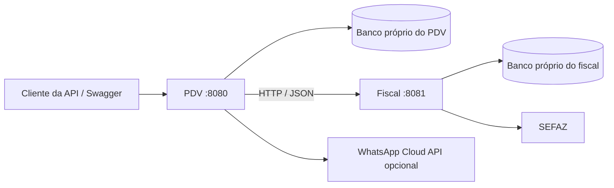

# ISA PDV — serviço de vendas e estoque

API de ponto de venda em Java 21 e Spring Boot 4.0.0. Faz parte da demonstração acadêmica de microserviços deste repositório: o PDV gerencia vendas e estoque, e o [serviço fiscal](../README.md) concentra emissão e documentos fiscais.

Este diretório contém o backend do PDV. A interface visual do PDV não está incluída. A API pode ser explorada pelo Swagger em `http://localhost:8080/swagger-ui/index.html`.

## Responsabilidades e fluxo



O PDV cadastra lojas, usuários, produtos, estoque e movimentações. A venda é aberta para um operador, recebe itens por código de barras, aceita desconto e é finalizada com forma de pagamento. A emissão de NFC-e pode ser solicitada depois ou pelo endpoint que finaliza e solicita emissão.

`FiscalIntegrationService` transforma a venda em um payload com CNPJ da loja, identificador da venda e itens. Envia esse JSON ao fiscal, registra o retorno fiscal na venda e recupera XML/PDF. Há geração de DANFE térmico e envio opcional de documentos por WhatsApp. O PDV não acessa as tabelas do fiscal.

As aplicações são dois processos independentes e têm bancos próprios. A chamada HTTP é síncrona; este projeto não implementa um broker de mensagens ou transação distribuída. Uma venda finalizada e uma nota autorizada são estados distintos. Falhas e rejeições fiscais devem ser conferidas antes de considerar o fluxo concluído.

## Compatibilidade da integração fiscal

**Existe uma pendência de autenticação entre as versões publicadas.** O cliente fiscal deste PDV envia `X-Integration-Token`, mas não implementa login nem armazenamento de cookie JWT do fiscal. O serviço fiscal publicado exige cookie autenticado além desse token. Portanto, configurar somente `FISCAL_TOKEN` não basta: a comunicação direta com aquela versão responde `401`.

Para uma demonstração completa, será necessário implementar a autenticação de serviço no cliente do PDV ou um mecanismo de autenticação entre serviços no fiscal. Essa publicação sanitiza e documenta o código existente; os testes do PDV usam um servidor fiscal simulado e não comprovam autenticação real entre as duas aplicações.

O contrato de negócio já implementado é:

| Método | Rota no fiscal | Uso |
| --- | --- | --- |
| POST | `/api/integracoes/pdv/nfce` | Enviar a venda para emissão |
| GET | `/api/integracoes/pdv/nfce/vendas/{id}/pdf?lojaCnpj={cnpj}` | Recuperar PDF pela venda |
| GET | `/api/integracoes/pdv/nfce/vendas/{id}/xml?lojaCnpj={cnpj}` | Recuperar XML pela venda |

O CNPJ da loja deve corresponder a uma empresa ativa configurada para NFC-e no fiscal. O retorno HTTP deve ser avaliado junto ao resultado fiscal; HTTP `200` sozinho não comprova autorização da SEFAZ.

## Configuração sem segredos no código

O arquivo [.env.example](.env.example) lista as variáveis. O Spring Boot não carrega `.env` automaticamente: configure-as no terminal, IDE, hospedagem ou por `docker run --env-file`.

| Variável | Uso |
| --- | --- |
| `SPRING_PROFILES_ACTIVE` | `dev` para H2 em memória; `prod` para MySQL |
| `JWT_SECRET` | Chave Base64 aleatória com pelo menos 32 bytes, exclusiva deste serviço |
| `JWT_EXPIRATION_MS` | Validade do JWT em milissegundos |
| `APP_SECURITY_BOOTSTRAP_ADMIN_ENABLED` | `true` somente para criar o primeiro administrador |
| `APP_SECURITY_BOOTSTRAP_ADMIN_PASSWORD` | Senha própria do primeiro administrador |
| `APP_SECURITY_BOOTSTRAP_ADMIN_LOGIN` / `NAME` | Login e nome do administrador |
| `APP_SECURITY_BOOTSTRAP_ADMIN_STORE_CODE` / `STORE_NAME` | Código e nome da loja inicial |
| `APP_CORS_ALLOWED_ORIGINS` | Origens permitidas em produção, separadas por vírgula |
| `DB_URL` / `DB_USER` / `DB_PASS` | URL JDBC MySQL e credenciais externas |
| `MYSQLHOST`, `MYSQLPORT`, `MYSQLDATABASE`, `MYSQLUSER`, `MYSQLPASSWORD` | Alternativa para o serviço MySQL da hospedagem |
| `JPA_DDL_AUTO` | Em produção o padrão é `validate`; o exemplo permite `update` para ambiente inicial de demonstração |
| `FISCAL_BASE_URL` | URL do fiscal, padrão `http://localhost:8081` |
| `FISCAL_TOKEN` | Token da integração fiscal, armazenado somente no backend |
| `WHATSAPP_ACCESS_TOKEN` | Token da API WhatsApp |
| `WHATSAPP_PHONE_NUMBER_ID` | Identificador do número do WhatsApp |
| `WHATSAPP_VERIFY_TOKEN` | Segredo escolhido para verificação do webhook |
| `WHATSAPP_APP_SECRET` | Segredo para validação da assinatura do webhook |
| `WHATSAPP_BASE_URL` / `WHATSAPP_API_VERSION` | Endereço e versão da API externa |
| `PORT` | Porta HTTP, padrão `8080` |

Não há senha padrão de usuário na aplicação publicada. O seed com credenciais de teste fica restrito ao perfil `test`, com configuração em `src/test/resources`, fora do JAR da aplicação. No perfil `dev`, o H2 é temporário: os dados desaparecem quando o processo termina. O console H2 está desabilitado.

O webhook WhatsApp valida assinatura quando `WHATSAPP_APP_SECRET` está configurado. Configure esse segredo antes de expor o webhook na internet. A integração WhatsApp depende também das credenciais e permissões da conta externa.

## Executar localmente a versão publicada

Requisito: JDK 21. Na pasta `pdv`, use PowerShell:

```powershell
$jwtBytes = New-Object byte[] 32
$rng = [System.Security.Cryptography.RandomNumberGenerator]::Create()
$rng.GetBytes($jwtBytes)
$rng.Dispose()
$env:JWT_SECRET = [Convert]::ToBase64String($jwtBytes)
$env:SPRING_PROFILES_ACTIVE = 'dev'
$env:APP_SECURITY_BOOTSTRAP_ADMIN_ENABLED = 'true'
$adminPassword = Read-Host 'Defina a senha do administrador do PDV' -AsSecureString
$env:APP_SECURITY_BOOTSTRAP_ADMIN_PASSWORD = [System.Net.NetworkCredential]::new('', $adminPassword).Password
.\mvnw.cmd spring-boot:run
```

Abra o Swagger e faça `POST /signin` com `username` e `password` definidos no ambiente. O login retorna JWT e cookie HttpOnly. O PDV aceita `Authorization: Bearer <JWT>` ou o cookie. No Swagger, informe o JWT no botão **Authorize**.

Em MySQL persistente, desligue o bootstrap após criar o administrador. No H2 em memória, o bootstrap precisa ser repetido ao iniciar um banco vazio. Use chaves JWT diferentes para PDV e fiscal.

## APIs principais

| Área | Rotas |
| --- | --- |
| Login | `POST /signin`, `POST /logout` |
| Lojas | `/api/lojas` |
| Usuários | `/api/usuarios`, `/api/usuarios/me` |
| Produtos | `/api/produtos` |
| Venda | `POST /api/pdv/vendas/abrir` |
| Itens | `POST /api/pdv/vendas/{id}/itens` |
| Desconto | `POST /api/pdv/vendas/{id}/desconto` |
| Finalização | `POST /api/pdv/vendas/{id}/finalizar` |
| Emissão | `POST /api/pdv/vendas/{id}/emitir-nfce` |
| Finalizar e emitir | `POST /api/pdv/vendas/{id}/finalizar-e-emitir-nfce` |
| Documentos | `GET /api/pdv/vendas/{id}/nfce/pdf`, `/pdf-termico`, `/xml` |
| WhatsApp | `POST /api/whatsapp/vendas/{id}/nfce` |
| Webhook | `GET/POST /api/whatsapp/webhook` |

Consulte o Swagger para os schemas e campos obrigatórios. A autorização considera o usuário autenticado e sua loja. O código mapeia perfis de usuário para as permissões usadas pelos endpoints.

Para demonstrar a venda: crie um produto, registre estoque na loja do operador, abra a venda, adicione um item pelo código de barras e finalize. A etapa fiscal depende da configuração do emitente e da pendência de autenticação descrita acima.

## Banco, testes e pacote

Entidades JPA persistem lojas, usuários, produtos, estoque por loja, movimentações, vendas e itens. Em produção o schema é validado; scripts incrementais existentes estão em [docs/sql](docs/sql). Esses scripts não representam uma migração inicial completa de um banco vazio. Para um banco acadêmico novo, `JPA_DDL_AUTO=update` pode criar as tabelas.

```powershell
.\mvnw.cmd clean verify
java -jar target/isa-0.0.1-SNAPSHOT.jar
```

No Linux/macOS, use `sh mvnw clean verify`. Os testes usam H2 em memória, mocks e servidores HTTP locais; não precisam de credenciais reais de SEFAZ, WhatsApp ou MySQL. Os testes ficam em `src/test`.

## Deploy por Docker

```bash
docker build -t isa-pdv .
docker run --rm --name isa-pdv --env-file .env -p 8080:8080 isa-pdv
```

Crie `.env` a partir do exemplo e preencha as variáveis. Para persistência use o perfil `prod` e MySQL externo. Dentro de um container, `localhost:8081` aponta para o próprio container; configure `FISCAL_BASE_URL` com o endereço alcançável do fiscal na rede do ambiente.

Em produção use HTTPS e uma lista explícita em `APP_CORS_ALLOWED_ORIGINS`. Configure credenciais pela plataforma, mantenha certificados, bancos, logs e documentos fiscais fora do Git. A publicação no GitHub disponibiliza o código; executar na internet exige hospedagem Java 21 ou Docker.
